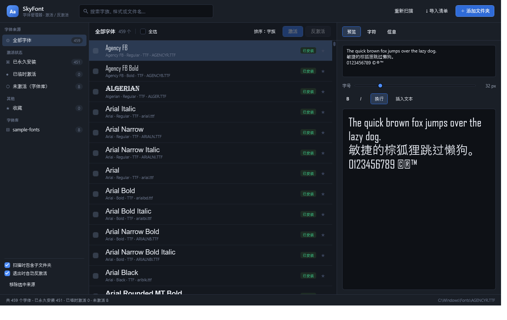
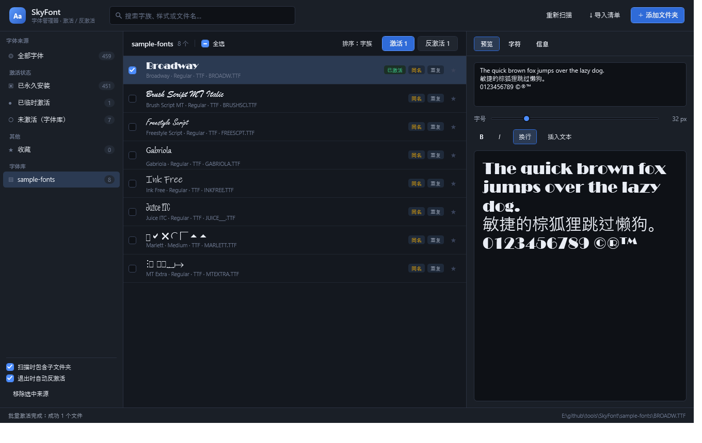
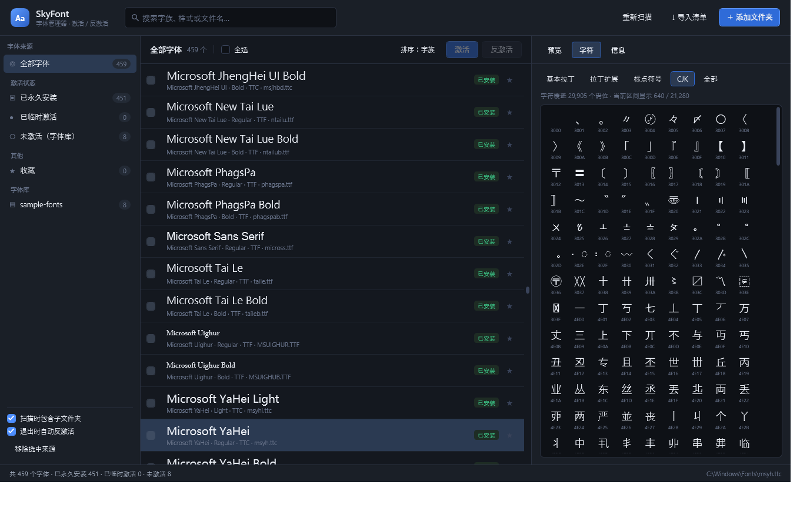

# SkyFont

Windows 字体管理器。浏览、预览、**激活 / 反激活** TrueType 与 OpenType 字体 —— 参考 NexusFont 的工作方式，用 C# + WPF 重新实现，单文件绿色运行。



---

## 1. 核心特性

| 能力 | 说明 |
| --- | --- |
| 字体库管理 | 添加任意文件夹作为字体库，支持递归扫描、拖放导入、多库并存 |
| 系统字体识别 | 读取 `HKLM` / `HKCU` 字体注册表，区分「已安装」与「库内字体」 |
| 会话级激活 | 无需管理员权限、不复制文件、不写注册表，激活后本会话内所有应用可用 |
| 批量勾选 | 列表工具栏提供三态「全选」（部分勾选显示半选），按钮实时显示 `激活 N / 反激活 N`；「全选」只作用于可激活的字体，永久安装的字体勾选框为禁用态；单次超过 50 个文件会二次确认 |
| 进度与可取消 | 批量激活在后台线程执行，界面不阻塞：浮层显示进度条、已完成 / 总数、当前文件名，可随时「取消」 |
| 反激活 | 通过 `RemoveFontResourceEx` 立即卸载，并通知所有窗口刷新字体列表 |
| 实时预览 | 预览文本、字号（10–120）、粗体/斜体模拟、自动换行、一键插入示例 |
| 字符映射表 | 直接解析 `cmap`，按区间列出该字体真实支持的码位，点击即可插入预览 |
| 字体信息 | 字族、样式、字重、字形数、unitsPerEm、版本、厂商、PostScript 名、字符覆盖量 |
| 检索与分组 | 按字族/文件名/字重排序，跨库全文搜索；来源按「激活状态 / 其他 / 字体库」分组筛选 |
| 冲突提示 | 与系统已装字体同名的条目显示「同名」标记，避免误判 |
| 收藏 | 星标收藏，独立来源筛选 |
| 状态持久化 | 窗口布局、预览设置、字体库、收藏、激活状态全部落盘 |
| 远程字体导入 | 读 JSON / XML 清单中的远程地址，下载到程序所在目录的 `downloads` 并自动登记为字体库 |





---

## 2. 激活机制

这是本项目与「复制到 Fonts 目录」类工具最本质的区别。

| 方式 | API | 作用范围 | 持久性 | 权限 |
| --- | --- | --- | --- | --- |
| **本工具采用** | `AddFontResourceEx(path, 0, NULL)` | 当前登录会话的所有进程 | 注销 / 重启后失效 | 普通用户 |
| 私有加载 | `AddFontResourceEx(path, FR_PRIVATE, NULL)` | 仅本进程 | 进程退出即失效 | 普通用户 |
| 永久安装 | 复制文件 + 写注册表 | 全系统、全用户 | 永久 | 通常需要管理员 |

工作流程：

```
激活：AddFontResourceEx → 记录到激活表 → EnumWindows 投递 WM_FONTCHANGE
反激活：RemoveFontResourceEx → 从激活表移除 → 再次广播
```

两点工程细节：

1. **广播不能用 `SendMessageTimeout(HWND_BROADCAST, WM_FONTCHANGE)`。**
   该调用是同步的，桌面上只要存在一个长时间不处理消息的窗口，调用线程就会被拖住（本项目开发环境实测可无限阻塞）。因此改为 `EnumWindows` 遍历顶层窗口后逐个 `PostMessage`，异步、不可阻塞。
2. **`.ttc` 的激活粒度是文件级。**
   一个 TrueType Collection 内部含多个字面，`AddFontResourceEx` 一次加载整个集合。因此界面中同一 `.ttc` 的多个字面共享同一激活状态，勾选任意一个都会同步全部。

退出策略：界面左下角有「**退出时自动反激活**」开关（默认开启，对应 `settings.json` 的 `DeactivateOnExit`）。

- 开启：关闭 SkyFont 时逐个调用 `RemoveFontResourceEx` 卸载本会话激活的字体，并广播 `WM_FONTCHANGE`，系统字体表不残留；
- 关闭：关闭时保留激活，下次启动自动恢复（同一登录会话内有效）；
- 无论开关状态，每次批量操作后都会把激活清单写入 `LastActivePaths`。因此即使进程被强杀，下次启动也会依据该清单**清理或恢复**，不会留下无人认领的激活；
- 若确实遇到残留（例如清单被手工删除），可用 `SkyFont.exe --deactivate <目录>` 强制卸载该目录下的字体。

---

## 3. 字体清单导入（远程字体）

字体不在本地、而是散落在 CDN、对象存储或团队文件服务器上时，用清单文件批量拉取：
点标题栏「**↓ 导入清单**」选择 `.json` / `.xml`，或直接把清单文件拖进窗口。

SkyFont 解析清单里的地址，把字体下载到**SkyFont.exe 同目录下的 `downloads`**（与清单放在哪里无关），完成后自动把该目录登记为
字体库并刷新列表 —— 不需要再手动「添加文件夹」。同一目录下可以有多个清单，共用同一个 `downloads`。

### JSON

```json
{
  "downloads": "downloads",
  "fonts": [
    "https://cdn.example.com/fonts/SourceHanSansSC-Regular.otf",
    { "name": "思源黑体 Bold", "url": "https://cdn.example.com/fonts/SHS-Bold.otf" },
    { "url": "https://cdn.example.com/fonts/Inter.ttf", "file": "Inter-Regular.ttf", "sha256": "9f2c…", "overwrite": true }
  ]
}
```

根节点也可以是纯数组：`["https://…/a.ttf", "https://…/b.otf"]`。

### XML

```xml
<?xml version="1.0" encoding="utf-8"?>
<fonts>
  <font name="思源黑体 Regular" url="https://cdn.example.com/fonts/SHS-Regular.otf" />
  <file>
    <url>https://cdn.example.com/fonts/Inter.ttf</url>
    <filename>Inter-Regular.ttf</filename>
  </file>
  <downloads dir="downloads" />
</fonts>
```

### 字段

| 字段 | 必填 | 说明 |
| --- | --- | --- |
| `url` / `href` / `link` / `src` | 是 | 仅接受 `http` / `https`，`ftp:`、`file:` 一律拒绝 |
| `name` / `title` | 否 | URL 里取不到文件名时用于生成文件名 |
| `file` / `filename` | 否 | 显式指定落盘文件名 |
| `sha256` | 否 | 下载后校验，不匹配则丢弃并报错 |
| `overwrite` | 否 | 同名文件是否覆盖，默认 `false` |
| `downloads` / `dir` | 否 | 下载目录名，默认 `downloads`，位置固定是程序所在目录；只接受单层目录名，防止写到程序目录之外 |

JSON 允许注释与尾逗号；XML 的 `<font>` / `<file>` / `<item>` / 裸 `<url>` 都能识别，属性与子元素两种写法等价。

### 下载行为

- 4 路并发，进度条可随时取消；单条失败不影响其余条目，结束后汇总提示；
- 连接抖动（握手超时、连接重置、5xx）会退避重试最多 3 次；4xx 与内容不合法不重试；
- 单文件上限 128 MB，先写 `.part`，校验通过才改名入位；
- **扩展名以真实文件头为准**：URL 写 `.otf` 但内容是 TTF，会存成 `.ttf`；HTML 错误页、压缩包等伪字体直接判失败；
- 识别 WOFF / WOFF2 并明确拒绝，不会把网页字体塞进字体库；
- 已存在且内容相同的文件直接跳过，重复导入同一份清单不会堆出 `(2)` 副本；
- **GitHub 网页地址会自动改写**：`github.com/…/blob/…` 返回的是 HTML 页面，清单里写这种地址会被改写成
  `raw.githubusercontent.com/…` 直链并给出提示；也可以直接写 raw 地址；
- 代理按 `HTTPS_PROXY` / `HTTP_PROXY` / `ALL_PROXY` 环境变量（如果存在），否则沿用系统代理设置。

### 命令行

```powershell
SkyFont.exe --import <清单文件>
```

无界面执行同样的流程，日志写到 `%TEMP%\SkyFont-import.log`；退出码 `0` 全部成功，`1` 有失败。
成功导入后字体库目录会写入 `settings.json`，下次启动仍然有效。

仓库里的 `samples/fonts.json` 与 `samples/fonts.xml` 是两份等价、可直接使用的示例
（从 expo/google-fonts 拉取 Andada Regular）。

---

## 4. 构建与运行

环境要求：**.NET 9 SDK**（开发）/ **.NET 9 桌面运行时**（运行框架依赖版）。

```powershell
# 框架依赖单文件（约 370 KB，需已安装 .NET 9 Desktop Runtime）
.\build.ps1

# 自包含单文件（约 60 MB，任意 x64 Windows 直接运行）
.\build.ps1 -SelfContained

# 指定架构
.\build.ps1 -Runtime win-arm64
```

产物位于 `publish\SkyFont.exe`，**目录里只有这一个文件**，没有 dll / deps.json / runtimeconfig.json / pdb。

> 注意：单文件打包只在 `dotnet publish` 阶段生效。直接 `dotnet build`，或在 Visual Studio 里点「生成」，
> 得到的是 `bin\Release\net9.0-windows\` 下的 `SkyFont.exe + SkyFont.dll + deps.json + runtimeconfig.json + pdb`，
> 那是编译中间产物（exe 只是个启动器，真正的逻辑在 dll 里），不能单独拷出去分发。
> 在 VS 里要出单文件，请用右键项目 →「发布」→ 选择 `win-x64` 配置文件，输出同样落在 `publish\`。

也可以直接开发态运行：

```powershell
dotnet run --project src\SkyFont\SkyFont.csproj
```

文档截图由脚本生成（界面改动后可一键刷新）：

```powershell
.\make-screenshots.ps1                       # 生成 docs\ 下三张图
.\make-screenshots.ps1 -Exe .\publish\SkyFont.exe
```

它会临时把 `settings.json` 换成截图用状态（字体库指向 `sample-fonts`、窗口 1360×860），拍完自动还原。

---

## 5. 使用说明

1. **添加字体库**：右上角「＋ 添加文件夹」，或直接把文件夹/字体文件拖进窗口。
   字体在远端时改用「↓ 导入清单」，见第 3 节。
2. **浏览与筛选**：左侧来源分组为「全部字体 / 激活状态（已永久安装 · 已临时激活 · 未激活）/ 其他（收藏）/ 字体库」，顶部搜索框实时过滤。
   三类状态互斥：永久安装的字体不会出现在「未激活」中，其行首复选框为禁用灰块，「全选」也会跳过它们。
3. **激活**：先勾选一个或多个字体（勾选只是标记待办，不会立即生效），也可以用工具栏的「全选」一次勾选当前列表全部条目；
   按钮会实时显示勾选数量（如「激活 3」），点击后才执行。
   在「未激活 / 已临时激活」这类按状态过滤的视图中，执行后列表会自动刷新；切换来源或修改搜索条件时会清空勾选，避免对不可见条目误操作。
4. **预览**：右侧「预览」页可修改示例文本、字号、粗体/斜体、换行；「字符」页查看码位覆盖；「信息」页查看完整元数据。
5. **收藏**：行尾星标。

快捷键：

| 按键 | 功能 |
| --- | --- |
| `Ctrl + F` | 聚焦搜索框 |
| `F5` | 重新扫描 |

---

## 6. 命令行

```text
SkyFont.exe                          启动图形界面
SkyFont.exe --selftest [字体路径]     自检：解析 → 激活 → GDI 可见性 → 反激活
SkyFont.exe --scan <目录>            扫描目录，输出解析摘要到 %TEMP%\SkyFont-scan.log
SkyFont.exe --deactivate <目录>      把该目录下的字体从当前会话卸载（清理异常退出残留）
SkyFont.exe --import <清单文件>      下载清单中的远程字体并登记为字体库（日志 %TEMP%\SkyFont-import.log）
SkyFont.exe --makeicon <路径>        重新生成多尺寸应用图标
SkyFont.exe --shot <png> [pane] [crop] [scale]
                                     渲染界面截图（调试用）
                                       pane  = preview | chars | info | active | search:<文本>
                                       pane 可追加 `@字体关键字` 选字体、`#区间` 选字符区间
                                             （latin / latinext / punct / cjk / all）
                                             例：chars#cjk@yahei
                                       crop  = x,y,w,h（按窗口坐标裁剪）
                                       scale = 整数放大倍率
```

`--selftest` 会挑选一个「未注册且当前 GDI 不可见」的字体做判定，输出示例：

```text
[2] 会话级激活 AddFontResourceEx
    结果 : 成功（1 ms）
    激活后字族数 : 455
    字族可见     : 是
[3] 广播 WM_FONTCHANGE（EnumWindows + PostMessage）
    结果 : 已投递（9 ms，非阻塞）
[4] 反激活 RemoveFontResourceEx
    结果 : 成功（0 ms）
    字族残留 : 否
==================================================
激活可见性检查 : PASS
反激活清理检查 : PASS
自检结果 : PASS
```

---

## 7. 数据位置

| 路径 | 内容 |
| --- | --- |
| `%APPDATA%\SkyFont\settings.json` | 字体库列表、预览设置、收藏、窗口状态、激活记录 |
| `%APPDATA%\SkyFont\fontindex.json` | 字体元数据索引缓存（按路径+大小+修改时间命中） |
| `%APPDATA%\SkyFont\error.log` | 未处理异常记录 |

删除整个目录即可恢复出厂状态。

---

## 8. 目录结构

```text
SkyFont/
├─ SkyFont.sln
├─ build.ps1 / build.cmd            构建脚本
├─ make-screenshots.ps1             重新生成 docs/ 下的截图
├─ assets/SkyFont.ico               多尺寸图标
├─ docs/                            文档截图
└─ src/SkyFont/
   ├─ App.xaml(.cs)                 入口、命令行分发、崩溃日志
   ├─ MainWindow.xaml(.cs)          主界面与交互
   ├─ Themes/Sky.xaml               深色主题与控件模板
   └─ Core/
      ├─ FontParser.cs              sfnt / TTC / name / OS-2 / head / maxp / cmap 解析
      ├─ FontEntry.cs               字体条目模型（预览 FontFamily 惰性构造）
      ├─ FontScanner.cs             目录扫描（含符号链接防护）
      ├─ FontCache.cs               索引缓存
      ├─ InstalledFonts.cs          注册表定位已安装字体
      ├─ FontActivator.cs           激活 / 反激活 / 广播
      ├─ FontManifest.cs            JSON / XML 清单解析（容错多种写法）
      ├─ FontDownloader.cs          远程字体下载、文件头校验、SHA-256
      ├─ ManifestImporter.cs        导入流程编排（界面与命令行共用）
      ├─ AppSettings.cs             配置持久化
      ├─ SelfTest.cs                命令行自检与目录导出
      ├─ IconMaker.cs               图标生成
      └─ SourceItem.cs              来源与字符格模型
```

---

## 9. 实现要点

- **自研字体解析器**：直接按 sfnt 规范读取表目录，不依赖 GDI/DirectWrite 的字体枚举，因此能正确处理 `.ttc` 多字面、`name` 表多语言优先级（Windows UTF-16BE > Unicode > Mac Roman，英语优先）、`OS/2` 字重宽度与 `head.macStyle` 的粗斜体标志。
- **字符覆盖靠 `cmap`**：解析 format 4（BMP）与 format 12（全平面）子表，得到字体真实支持的码位集合，而不是「渲染一遍看有没有豆腐块」。
- **按需读表**：解析时只 seek 读取表目录与 `name`/`OS/2`/`head`/`maxp` 等小表，不整文件载入。364 个系统字体全量解析约 175 ms。
- **增量索引**：元数据按「路径 + 文件大小 + 修改时间」缓存到 JSON，二次启动基本零解析。
- **列表虚拟化**：`VirtualizingStackPanel` + Recycling，数千条目滚动不掉帧；每行字体名用其自身字面渲染。
- **预览走 WPF 文件 URI 字体族**：未安装字体用 `file:///…/#FamilyName` 直接加载，与系统字体表状态无关，保证「未激活也能看」。
- **下载不信任 URL**：清单里的地址只当作「数据来源」，落盘前用文件头魔数判定真实格式，扩展名以内容为准；
  同名文件先比 SHA-256 再决定跳过或另存，因此清单可以反复导入而不会堆出副本。

---

## 10. 已知限制

1. 仅支持 **TTF / OTF / TTC / OTC**；不支持 WOFF / WOFF2 等网页字体（`--selftest` 与解析器会明确报错而不是静默失败）。
2. **可变字体（Variable Font）只按默认实例显示**，不枚举命名实例（Named Instances）。
3. 会话级激活**不会**改变文件关联或让新启动的 UWP/系统级服务识别字体；个别已经运行的应用可能需要重启才能刷新字体下拉列表。
4. 激活不复制文件：**字体文件被移动或删除后，激活即失效**。
5. 有意**不提供永久安装/卸载**功能 —— 避免误写系统字体目录与注册表。确有需要请使用系统「设置 → 字体」或拖入 `%LOCALAPPDATA%\Microsoft\Windows\Fonts`。
6. 与系统同名字族的库内字体（界面标记「同名」）即使激活，也可能被系统字体优先匹配。

---

## 11. 许可

本项目代码可自由使用与修改。`docs/` 中的截图仅用于说明界面。
